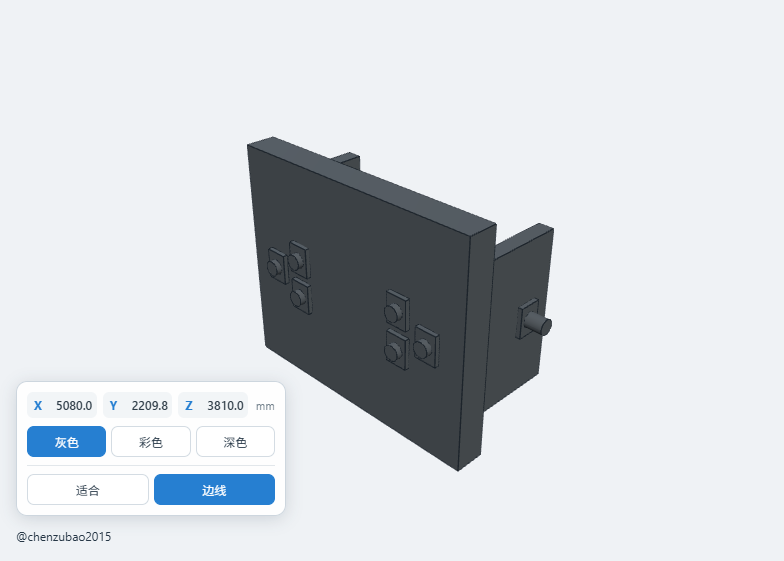

# QuickLook.Plugin.StepViewer

中文 | [English](README_EN.md)

Windows [QuickLook](https://github.com/QL-Win/QuickLook) 的离线 CAD 三维预览插件。选中文件并按空格键，即可快速预览 STEP、IGES 和 OpenCascade BREP 模型。



## 特性

- 支持 `.stp`、`.step`、`.igs`、`.iges`、`.brep`
- OpenCascade WebAssembly 本地解析，不上传模型文件
- 默认灰色模型，可切换灰色、逐面彩色和深色
- 显示模型原始 X、Y、Z 外形尺寸，单位为毫米
- 拖动空白区域：原地旋转模型
- 抓住模型拖动：移动模型位置
- 鼠标滚轮：缩放模型
- 适合窗口和边线显示开关
- 支持包含中文、空格和特殊字符的文件路径
- 外部作者链接通过系统默认浏览器安全打开

## 支持格式

| 格式 | 扩展名 | OpenCascade 接口 |
|---|---|---|
| STEP | `.stp`、`.step` | `ReadStepFile` |
| IGES | `.igs`、`.iges` | `ReadIgesFile` |
| OpenCascade BREP | `.brep` | `ReadBrepFile` |

STL、OBJ、PLY、FBX、3MF、glTF 等网格格式继续由 QuickLook 自带的 3D 插件处理，本插件不会抢占这些扩展名。

## 安装

### 从 Releases 安装

1. 在仓库右侧打开 **Releases**。
2. 下载最新版 `QuickLook.Plugin.StepViewer.qlplugin`。
3. 确保 QuickLook 正在运行。
4. 选中下载的 `.qlplugin` 文件并按空格键。
5. 点击 **Install**。
6. 从系统托盘完全退出并重新启动 QuickLook。
7. 选中受支持的 CAD 文件，按空格键预览。

> 系统需要 Microsoft Edge WebView2 Runtime。Windows 10/11 通常已预装。

## 使用

| 操作 | 功能 |
|---|---|
| 拖动空白区域 | 模型原地旋转 |
| 拖动模型 | 移动模型位置 |
| 滚动鼠标滚轮 | 缩放模型 |
| 灰色 / 彩色 / 深色 | 切换模型材质 |
| 适合 | 恢复适合窗口的大小与位置 |
| 边线 | 显示或隐藏模型边线 |

左下角显示的是文件原始坐标系下的包围盒尺寸，不会因界面中的旋转、移动或缩放而改变。

## 从源码构建

### 环境要求

- Windows 10/11
- Node.js 与 npm
- .NET 8 SDK
- PowerShell

项目输出目标为 .NET Framework 4.6.2，但使用 .NET 8 SDK 执行构建。

### 构建安装包

```powershell
powershell -ExecutionPolicy Bypass -File .\Scripts\pack.ps1
```

生成：

```text
QuickLook.Plugin.StepViewer.qlplugin
```

### 生成源码归档

```powershell
powershell -ExecutionPolicy Bypass -File .\Scripts\package-source.ps1
```

## 技术架构

```text
QuickLook IViewer
       │
       ▼
WPF WebView2 宿主
       │
       ├── 虚拟主机读取本地 CAD 文件
       ▼
occt-import-js / OpenCascade WASM
       │
       ├── STEP  → ReadStepFile
       ├── IGES  → ReadIgesFile
       └── BREP  → ReadBrepFile
       ▼
Three.js 网格、尺寸、逐面材质与交互渲染
```

主要文件：

- `Plugin.cs`：QuickLook `IViewer` 生命周期和扩展名识别。
- `StepViewerPanel.cs`：WPF WebView2 宿主、本地文件映射和外部链接处理。
- `Web/viewer-src.js`：格式分派、Three.js 渲染、尺寸、颜色与鼠标交互。
- `Web/index.html`、`Web/viewer.css`：预览界面。
- `Scripts/pack.ps1`：构建 `.qlplugin` 安装包。

## 隐私与安全

- CAD 文件只在本机读取和解析。
- 插件不会上传模型，也不依赖在线转换服务。
- 作者链接仅允许通过 HTTPS 打开 `github.com`，并交给系统默认浏览器处理。

## 已知说明

- 大型装配体的首次三角化需要一定时间，速度取决于模型复杂度和计算机性能。
- BREP 文件本身通常不携带 STEP/IGES 那样完整的产品结构和颜色信息。
- 界面显示的是三角化结果，不是 CAD 编辑器，不能修改实体特征。

## 参与贡献

欢迎提交 Issue 和 Pull Request：

1. Fork 仓库并创建功能分支。
2. 完成修改并在 QuickLook 中实测。
3. 确保 `.stp/.step/.igs/.iges/.brep` 不发生回退。
4. 提交 Pull Request，说明变更内容和验证结果。

## 许可证

本插件源码采用 [MIT License](LICENSE.txt)。第三方组件及其许可证见 [THIRD-PARTY-NOTICES.txt](THIRD-PARTY-NOTICES.txt)。

## 作者

[@chenzubao2015](https://github.com/chenzubao2015)
