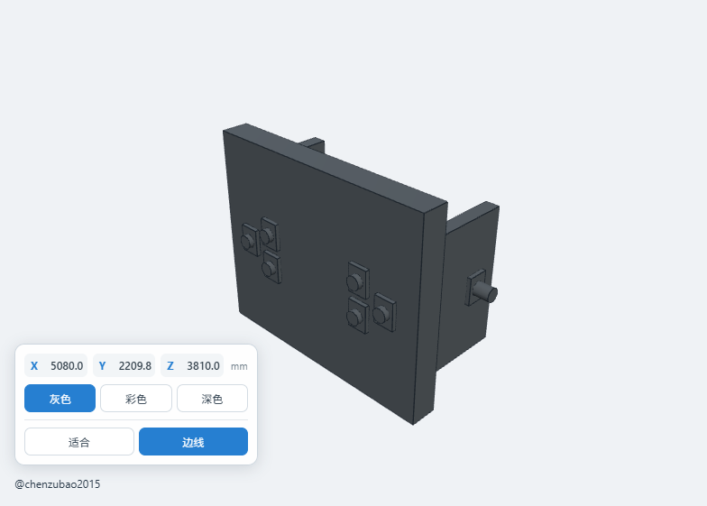

# QuickLook.Plugin.StepViewer

[中文](README.md) | English

An offline CAD preview plugin for [QuickLook](https://github.com/QL-Win/QuickLook) on Windows. Select a STEP, IGES, or OpenCascade BREP file and press Space to preview it instantly.



## Features

- Supports `.stp`, `.step`, `.igs`, `.iges`, and `.brep`
- Parses models locally with OpenCascade WebAssembly; files are never uploaded
- Gray by default, with gray, per-face colorful, and dark material modes
- Displays the original X, Y, and Z bounding-box dimensions in millimeters
- Drag empty space to rotate the model in place
- Drag the model to move it
- Use the mouse wheel to scale it
- Fit-to-view and edge display controls
- Supports file paths containing non-ASCII characters, spaces, and special characters

## Supported formats

| Format | Extensions | OpenCascade API |
|---|---|---|
| STEP | `.stp`, `.step` | `ReadStepFile` |
| IGES | `.igs`, `.iges` | `ReadIgesFile` |
| OpenCascade BREP | `.brep` | `ReadBrepFile` |

Mesh formats such as STL, OBJ, PLY, FBX, 3MF, and glTF remain handled by QuickLook's built-in 3D viewer. This plugin does not claim those extensions.

## Installation

1. Open **Releases** and download `QuickLook.Plugin.StepViewer.qlplugin`.
2. Make sure QuickLook is running.
3. Select the downloaded `.qlplugin` file and press Space.
4. Click **Install**.
5. Fully quit QuickLook from the system tray and start it again.
6. Select a supported CAD file and press Space.

> Microsoft Edge WebView2 Runtime is required. It is normally preinstalled on Windows 10 and Windows 11.

## Controls

| Input | Action |
|---|---|
| Drag empty space | Rotate model in place |
| Drag model | Move model |
| Mouse wheel | Scale model |
| Gray / Colorful / Dark | Change material mode |
| Fit | Reset size and position to fit the window |
| Edges | Toggle model edges |

The dimensions shown in the lower-left corner are calculated in the original file coordinate system and do not change when the model is moved, rotated, or scaled in the viewer.

## Build from source

Requirements:

- Windows 10/11
- Node.js and npm
- .NET 8 SDK
- PowerShell

Build the `.qlplugin` package:

```powershell
powershell -ExecutionPolicy Bypass -File .\Scripts\pack.ps1
```

Generate a source archive:

```powershell
powershell -ExecutionPolicy Bypass -File .\Scripts\package-source.ps1
```

## Architecture

```text
QuickLook IViewer
       │
       ▼
WPF WebView2 host
       │
       ├── Local CAD file through WebView2 virtual host mapping
       ▼
occt-import-js / OpenCascade WASM
       │
       ├── STEP  → ReadStepFile
       ├── IGES  → ReadIgesFile
       └── BREP  → ReadBrepFile
       ▼
Three.js rendering, dimensions, per-face colors, and interaction
```

## Privacy

CAD files are read and parsed locally. The plugin does not upload models and does not use an online conversion service.

## Known notes

- Large assemblies may take time to triangulate depending on model complexity and hardware.
- BREP files may not contain the same product structure or color metadata as STEP/IGES files.
- The plugin displays triangulated geometry; it is not a CAD editor.

## Contributing

Issues and pull requests are welcome. Please do not publicly upload confidential CAD files. Use a simplified or sanitized model when a sample is needed to reproduce a problem.

## License

Plugin source code is available under the [MIT License](LICENSE.txt). Third-party notices are listed in [THIRD-PARTY-NOTICES.txt](THIRD-PARTY-NOTICES.txt).

## Author

[@chenzubao2015](https://github.com/chenzubao2015)
